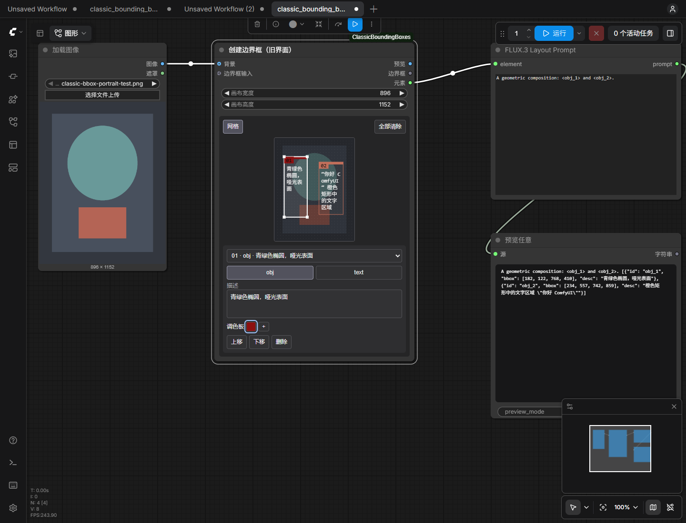

# ComfyUI Classic Bounding Boxes

[English](README_EN.md)

让官方“创建边界框”节点在 **旧版 LiteGraph 界面**中正常绘制与编辑。节点可横向、纵向调整大小，内部画布随节点宽度缩放。



## 实现方式

- **直接继承官方 `CreateBoundingBoxes` 后端**，仅修改节点 ID、显示名称、分类；执行逻辑不重写。
- 前端复用官方 `boundingBoxesUtil.ts` 的命中检测、拖动和坐标转换函数，补充旧界面的 DOM 编辑器。
- 保留官方 `editor_state` / `last_incoming` 数据格式，随工作流保存；不覆盖官方节点，不全局修改其他节点。
- 输出仍为 `IMAGE / BOUNDING_BOX / ARRAY`，顺序与官方一致，可接回官方 FLUX.3 Layout Prompt、Build JSON Prompt 等节点。

## 安装

在 **ComfyUI 的 `custom_nodes` 文件夹**中执行：

```bash
git clone https://github.com/Yxw052/ComfyUI-ClassicBoundingBoxes.git
```

重启 ComfyUI，再刷新浏览器。无需安装额外 Python 包，无需 npm 构建。

**要求：** ComfyUI 必须包含官方 `comfy_extras.nodes_bounding_boxes` 和 V3 节点 API。“旧界面”指关闭 Nodes 2.0，不代表兼容很久以前的 ComfyUI 后端。实测环境为 ComfyUI **0.41.3**、前端 **1.55.17**、Chrome/Chromium。

## 使用

1. 关闭 Nodes 2.0，搜索 **创建边界框（Nodes1.0）** 或 **Create Bounding Boxes (Nodes1.0)**。
2. 用此节点替换原先显示“仅限 Node 2.0”的节点，重新连接原来的输入、输出线。
3. 可选：将“加载图像”的图像输出接到“背景”。其他上游图像节点需要先运行一次，才能取得背景预览。
4. 直接在空白处拖动画框；按住 Shift，可在已有框内继续画框。
5. 拖动框体移动；拖动四角或边缘调整框大小。在下方编辑对象/文字类型、文字、描述和最多 5 个颜色。
6. 拖动**节点外框右下角**改变节点宽高。画布宽度/高度参数控制坐标分辨率，与节点显示尺寸分开。

“网格”使用与官方一致的 32 像素吸附规则，大画布会调整步长以限制网格数量。悬浮区域菜单可选择重叠区域，打开时不移动下方控件、不改变图片尺寸；`obj / text` 按下即切换。工具栏依次为 **网格、删除、全部清除**；删除只影响选中区域，全部清除直接执行。也可按 Delete 删除当前区域。在节点图片、文字编辑区及下方空白处滚动鼠标滚轮，会按 ComfyUI 的工作区设置缩放或平移整个画面。

调色板采用官方风格的色块和弹出选色器：点击编辑，右键删除，拖动色块排序，“+”添加白色；选色器提供方形色域、色相条和十六进制/RGB输入。界面不显示“×”、额外分辨率文字或操作说明。图片直接使用原图文件完整缩小显示，框线画布按工作区缩放和屏幕像素比调整分辨率，避免放大小位图造成的模糊。图片尺寸只由节点宽度和原图比例决定；切换 `obj/text` 或输入长文字时保持不变，空间不足则向下增加节点高度。编辑器与文本框不依赖内部滚动条。

[查看调色板截图](docs/color-picker-zh.png)

中文/英文随 ComfyUI 的界面语言切换。节点标题、端口、参数与提示使用官方 `locales/*/nodeDefs.json` 机制；中文文本按 Unicode 随工作流保存。**预览图中文字的字体渲染仍由官方后端决定**，本适配不更换官方预览字体。

## 示例

将 [example_workflows/classic_bounding_boxes.json](example_workflows/classic_bounding_boxes.json) 拖入 ComfyUI，即可看到两个带中文描述的区域，并通过“预览为文本”查看 FLUX.3 布局提示词。示例不需要模型或背景图片。

## 已验证

- 真实旧界面中：节点横向拉宽/缩窄、直接画框、移动、四角缩放、重叠框、网格吸附、删除、色块选色/拖动/右键删除、中文文字编辑。
- 320 像素宽的窄节点中，128 字符中文文字内容完整显示，文本框与编辑器无内部滚动溢出。
- 保存并重新载入工作流、整页刷新后，框体、文字、颜色及参数保持。
- 7 组运行对照：与官方节点的边界框、元素、预览图像素、FLUX.3 布局提示词全部一致。包含空输入、文字/调色板、像素框、批次框、归一化元素、JSON 输入与手动编辑优先级。
- 详细复现方法见 [docs/VALIDATION.md](docs/VALIDATION.md)。未宣称所有历史前端、其他节点包或浏览器均已验证。

## 开发检查

```bash
npm test
npm run check
# 使用 ComfyUI 自带 Python，并指向已加载本节点的独立测试实例：
python tests/backend_smoke.py --host http://127.0.0.1:8189
```

测试只执行图像/文本工具节点，不加载生成模型。后端测试会在所指实例的输出目录写入 `classic_bbox_smoke/` 测试预览。

## 来源与许可

GPL-3.0-or-later。官方代码来源与开发参考见 [NOTICE.md](NOTICE.md)。本仓库是社区兼容适配，并非 Comfy Org 官方项目。
